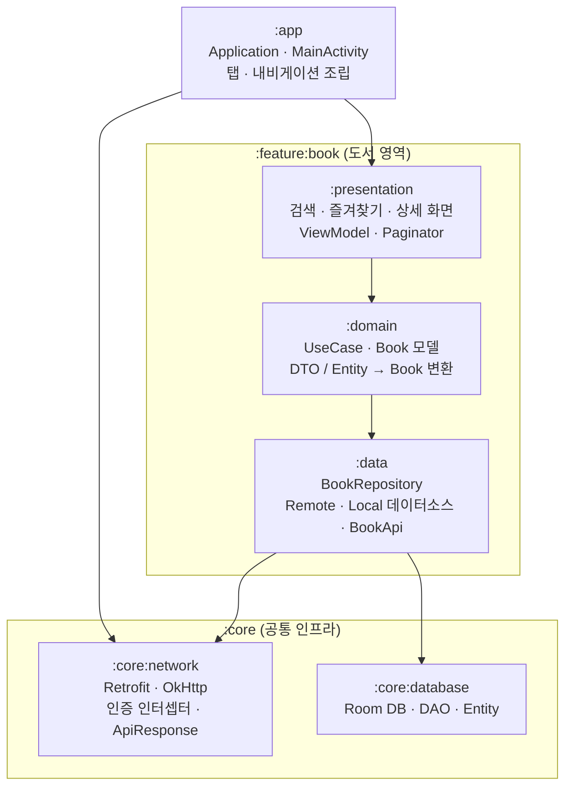

# 도서 검색 앱

| 일반 화면 | 펼친 폴더블 (두 칸) |
|---|---|
|  |  |


<!-- 스크린샷을 추가하면 위 셀의 안내 문구를  형태로 바꿔 주세요. -->


카카오 도서 검색 API로 책을 검색하고, 마음에 드는 책을 즐겨찾기에 저장해 다시 찾아볼 수 있는 Android 앱입니다.

- **검색 탭**: 검색어로 도서를 찾고 정확도순 · 발간일순으로 정렬합니다. 스크롤하면 다음 페이지를 이어서 불러옵니다.
- **즐겨찾기 탭**: 저장한 도서를 검색어 · 제목 정렬 · 금액 범위로 찾아봅니다. 네트워크가 없어도 동작합니다.
- **상세 화면**: 도서 정보와 소개를 보고 즐겨찾기를 추가 · 해제합니다.


이 앱은 "큰 앱의 기능 하나이고, 앞으로 기능과 개발자가 계속 늘어난다"는 전제로 구조를 잡았습니다. 이 저장소에서 작업할 때 지키는 규칙은 [CLAUDE.md](CLAUDE.md)에 정리되어 있습니다.

## 목차
1. [빌드 방법](#빌드-방법)
2. [사용 기술](#사용-기술)
3. [프로젝트 구조](#프로젝트-구조)
4. [주요 구현 포인트](#주요-구현-포인트)
   - [아키텍처](#1-아키텍처)
   - [Compose 리컴포지션 최적화](#2-compose-리컴포지션-최적화)
   - [페이징 처리](#3-페이징-처리)
   - [큰 화면 대응](#4-큰-화면-대응)
5. [AI 활용](#ai-활용)
6. [고려했지만 반영하지 않은 것](#고려했지만-반영하지-않은-것)

---

## 빌드 방법

### 요구 환경
| 항목 | 버전 |
|---|---|
| JDK | 17 |
| Gradle | 9.4.1 (Wrapper 포함) |
| Android Gradle Plugin | 9.2.1 |
| compileSdk / targetSdk | 37 |
| minSdk | 24 |

Gradle 데몬은 `gradle/gradle-daemon-jvm.properties` 설정에 따라 JDK 17로 실행됩니다.

### 1. 카카오 REST API 키 설정
프로젝트 루트의 `local.properties`에 키를 추가합니다. 키는 코드에 넣지 않고, 빌드할 때 `:core:network`의 `BuildConfig.KAKAO_API_KEY`로 들어갑니다. `local.properties`는 git에 올라가지 않습니다.

```properties
KAKAO_API_KEY=발급받은_REST_API_키
```

키가 없어도 빌드는 성공하지만, 검색 요청이 인증 오류(401)로 실패합니다.

### 2. Android SDK 위치
`local.properties`에는 SDK 경로(`sdk.dir`)를 넣지 않았습니다. SDK는 컴퓨터마다 설치 위치가 달라서, 각자의 환경에서 정해지도록 했습니다.

- **Android Studio로 여는 경우**: Studio가 자기 SDK 경로를 `local.properties`에 자동으로 추가하므로 따로 할 일이 없습니다.
- **커맨드라인으로 빌드하는 경우**: `ANDROID_HOME` 환경 변수에 SDK 경로를 지정하거나, `local.properties`에 `sdk.dir`을 직접 추가합니다. 둘 다 없으면 `SDK location not found` 오류로 빌드가 실패합니다.

```bash
export ANDROID_HOME=$HOME/Library/Android/sdk   # macOS 기본 설치 위치 예시
```

### 3. 빌드 · 실행
```bash
./gradlew assembleDebug        # 디버그 APK 빌드 → app/build/outputs/apk/debug/app-debug.apk
./gradlew installDebug         # 연결된 기기에 설치
./gradlew testDebugUnitTest    # 단위 테스트 실행
```

---

## 사용 기술

| 분류 | 기술 | 버전 | 용도 |
|---|---|---|---|
| 언어 | Kotlin | 2.4.0 | |
| 비동기 | Coroutines · Flow | 1.10.2 | 비동기 처리, 화면 상태(`StateFlow`) |
| UI | Jetpack Compose (BOM) | 2026.02.01 | Material3, `material3-adaptive-navigation-suite`(하단 탭 바 ↔ 레일) |
| 네비게이션 | Navigation3 | 1.2.0 | 탭별 백스택, 화면 이동 |
| | Material3 Adaptive Navigation3 | 1.3.0 | 넓은 화면의 목록 · 상세 두 칸(`ListDetailSceneStrategy`) |
| 생명주기 | Lifecycle | 2.11.0 | `lifecycle-viewmodel-navigation3`(화면별 ViewModel 범위), `collectAsStateWithLifecycle` |
| DI | Hilt (KSP) | 2.60.1 | 의존성 주입. kapt 대신 KSP 사용 |
| | AndroidX Hilt | 1.3.0 | `hiltViewModel`, 상세 화면 AssistedInject |
| 네트워크 | Retrofit2 · OkHttp | 2.12.0 · 4.12.0 | 카카오 도서 검색 API 호출 |
| 직렬화 | kotlinx.serialization | 1.11.0 | JSON 파싱, Navigation3 키 직렬화 |
| 로컬 DB | Room | 2.8.5 | 즐겨찾기 저장 |
| 이미지 | Coil 3 | 3.3.0 | 표지 이미지 로딩 · 캐시 |
| 테스트 | JUnit4, kotlinx-coroutines-test, testFixtures | | 단위 테스트, 모듈 간 Fake 공유 |

라이브러리 버전은 모두 `gradle/libs.versions.toml`(Version Catalog)에서 관리합니다.

---

## 프로젝트 구조

### 모듈 구조
기능은 **제품 영역 단위**(`:feature:book`)로 모듈을 나누고, 그 안을 다시 레이어(presentation / domain / data)로 나눴습니다. 여러 기능이 함께 쓰는 인프라는 `:core`에 둡니다.



- 화살표는 의존 방향입니다. 항상 **UI → Domain → Data** 한 방향이고, 반대 방향 의존은 없습니다.
- 다른 기능이 생기면 `:feature:<영역>:{presentation, domain, data}` 형태로 추가합니다. 기능 간 화면 이동은 `:app`의 내비게이션에서 조립하고, 한 기능의 presentation이 다른 기능의 presentation을 직접 알지 않습니다.

---

## 주요 구현 포인트

### 1. 아키텍처

#### Android 권장 아키텍처 + MVVM
[Android 권장 아키텍처](https://developer.android.com/topic/architecture)를 따릅니다.
- **근거**: 이 앱의 Repository는 구현이 하나뿐입니다. 인터페이스를 두면 파일과 바인딩이 늘어나고 이점이 없다고 판단했습니다. Android 공식 가이드도 Repository를 Data Layer에 두고, Domain Layer는 "선택"으로 둡니다.
- **domain은 필요할 때만 둡니다**: 비즈니스 로직(ISBN 정규화, 마지막 페이지 판단, 빈 검색어 처리)이 있는 곳만 UseCase로 만들었습니다. 로직 없이 넘기기만 하는 조회(예: 즐겨찾기 테이블 변경 신호)는 ViewModel이 Repository를 직접 씁니다.

#### 기능 모듈을 화면이 아니라 제품 영역 단위로
검색 · 즐겨찾기 · 상세를 화면별 모듈 3개로 나누지 않고 `:feature:book` 하나로 묶었습니다. 추후 여러 기능이 확장될 것을 고려하여 단위를 정했습니다.
- **근거**: 세 화면이 같은 `Book` 모델, 같은 Repository, 같은 즐겨찾기 저장소를 씁니다. 화면별로 나누면 검색 화면의 즐겨찾기 토글, 두 탭에서 들어가는 상세 화면 때문에 처음부터 기능끼리 서로 의존하게 됩니다.

#### 불안정한 네트워크를 전제로 한 결과 타입
지하철처럼 연결이 자주 끊기는 환경을 고려해, Retrofit 호출이 예외를 던지지 않고 `ApiResponse`(Success / HttpError / NetworkError / UnknownError)를 돌려주도록 CallAdapter를 만들었습니다.
- 화면은 실패 종류에 따라 문구를 고르고 "다시 시도"를 보여줍니다. 서버가 준 에러 메시지는 디버깅용으로만 `HttpError`에 남깁니다.
- 연결 · 읽기 타임아웃은 10초입니다. 즐겨찾기와 상세 화면은 로컬 DB와 내비게이션 키만 쓰므로 오프라인에서도 동작합니다.

#### DTO는 너그럽게, 앱 모델은 정규화하여 명확하게 구현
- **DTO**: API 문서에 required 여부가 명시되어 있지 않아 모든 필드를 기본값 없는 nullable로 두고, JSON 설정에 `explicitNulls = false`를 씁니다. 외부 서버는 필드를 항상 준다고 보장하지 않고, non-null 필드에 null이 하나만 와도 **응답 전체** 파싱이 실패하기 때문입니다.
- **앱 모델(`Book`)**: 변환할 때 필수 값(ISBN, 제목)이 없는 항목은 버리고, 가격 `-1` · 빈 썸네일은 null로 바꿉니다.
- **ISBN13 정규화**: 카카오 API는 `isbn`에 "ISBN10 ISBN13"을 공백으로 이어 주거나 하나만 줍니다. 어떤 조합이 와도 같은 책이 같은 키를 갖도록 ISBN13 하나로 맞춥니다(ISBN10은 978 + 체크 숫자 재계산). 이 값을 화면 키, 즐겨찾기 DB 기본키, 중복 제거 기준으로 함께 씁니다.

#### 화면 상태와 생명주기
- ViewModel은 화면 상태를 `StateFlow<UiState>` 하나로 내보내고, 화면은 `collectAsStateWithLifecycle()`로 받습니다.
- 화면 진입점(`*Route`)만 ViewModel을 알고, `*Screen`부터 그 아래 Composable은 상태와 콜백만 받습니다(state hoisting). 그래서 Preview를 상태별로 그릴 수 있습니다.
- **화면이 보일 때만 동작**: 입력 debounce 후 자동 검색과 즐겨찾기 다시 불러오기를 `init`에서 시작하지 않고 `uiState`(`SharingStarted.WhileSubscribed(5_000)`)에 묶었습니다. 다른 탭에 있으면 멈추고, 돌아오면 최신 상태로 한 번 맞춥니다.

#### 화면 간 즐겨찾기 동기화
즐겨찾기는 Room을 단일 진실 공급원(SSOT)으로 두고, 각 화면이 필요한 만큼만 구독합니다.
- **검색 · 상세**: 화면에 있는 책의 ISBN만 `isbn IN (...)`으로 구독합니다. SQLite 쿼리 인자 한도(3.32.0 미만은 999개) 때문에 500개씩 나눠 묻습니다.
- **즐겨찾기 목록**: 커서 페이지 조회는 한 번 읽는 함수라 변경을 알려주지 않습니다. 그래서 Room `invalidationTracker`로 테이블 변경 신호를 받아 다시 불러옵니다. 어느 화면에서 바꾸든(Repository를 거치지 않는 변경이 생기더라도) 반영됩니다.

#### 내비게이션 (Navigation3)
- 탭마다 백스택을 따로 둬서, 탭을 오가도 각 탭에서 연 상세 화면과 스크롤 위치가 남습니다.
- 상세 화면 키(`BookDetailNavKey`)에 `Book`을 담아 넘깁니다. **근거**: 카카오 도서 API에는 단건 조회가 없어 ISBN만으로는 상세 정보를 다시 가져올 수 없습니다. 키가 직렬화되므로 프로세스가 종료돼도 백스택과 함께 복원됩니다. 즐겨찾기 여부는 바뀔 수 있어 키에 담지 않고 상세 화면이 구독합니다.
- 화면을 열 때 정해지는 `Book`은 Hilt가 알 수 없어서 AssistedInject로 ViewModel에 전달합니다. Navigation3는 키를 `SavedStateHandle`에 넣어 주지 않기 때문입니다.

### 2. Compose 리컴포지션 최적화

**구조로 막은 불필요한 리컴포지션**
- **UI 모델 안정성**: `BookUiModel`, `SearchUiState`, `FavoriteUiState`를 `@Immutable`로 표시해 stable로 다룹니다.
- **검색어 입력 중 목록은 다시 그리지 않음**: 입력할 때 바뀌는 건 `query`뿐이고 결과(`result`)는 같은 객체라, 목록(`BookList`)은 건너뜁니다.
- **하트를 누르면 그 카드만 다시 그림**: 즐겨찾기가 바뀌면 목록은 새 리스트가 되지만, 카드는 `BookUiModel`을 `equals`로 비교해 바뀐 카드만 다시 그립니다.
- **즐겨찾기 재구독 최소화**: 검색 결과의 ISBN 목록에 `distinctUntilChanged()`를 걸어, 다음 페이지 로딩 표시처럼 책 목록이 그대로인 상태 변화에는 DB 구독을 다시 맺지 않습니다.
- **하트 깜빡임 방지**: 새 페이지가 먼저 도착하고 그 책들의 즐겨찾기 여부가 아직 없을 때 화면을 갱신하면 하트가 꺼졌다 켜집니다. `combineTransform`으로 두 값이 맞을 때만 상태를 내보냅니다.
- **라이브러리 동작 확인**: Navigation3는 백스택이 바뀔 때만 항목을 다시 만든다는 것(소스 확인), 썸네일 placeholder의 `ColorPainter`가 `equals`를 구현한다는 것(바이트코드 확인)을 확인해 추가 `remember`가 필요 없다고 판단했습니다.

### 3. 페이징 처리

#### 검색: 페이지 번호 방식
- 실제 API를 호출해 보며 문서에 없는 동작을 찾아 반영했습니다.
  - 결과가 0건이어도 `is_end`가 `false`로 옵니다 → `is_end`, 결과 개수, 요청한 페이지를 함께 보고 마지막 페이지를 판단합니다.
  - 50페이지를 넘어도 200으로 응답합니다 → 50페이지에서 직접 멈춥니다.
  - 빈 검색어는 항상 0건입니다 → 요청하지 않고, 검색 전 화면에 추천 검색어를 보여줍니다.
- **ISBN 기준 중복 제거**: 실제 API를 검색어 6개 × 정렬 2개 × 최대 5페이지로 조회해 보니, 같은 책이 판매처별로 따로 등록돼(ISBN 같음, 출판사 · 가격 다름) 같은 페이지 안이나 페이지 사이에 중복으로 왔습니다. 목록이 ISBN을 키로 쓰기 때문에 걸러내지 않으면 앱이 종료됩니다.
- **요청 관리**: 입력이 0.5초 멈추면 자동 검색하고, 같은 조건은 다시 요청하지 않으며, 새 검색을 시작하면 진행 중인 요청을 취소합니다. 실패한 검색은 사용자가 직접(키보드 검색 키 · 추천 검색어 · 다시 시도) 요청할 때만 다시 보냅니다.

#### 즐겨찾기: 커서(keyset) 방식
- `OFFSET`은 페이지가 뒤로 갈수록 앞의 행을 다시 세야 하고, 페이지를 넘기는 사이 추가 · 삭제가 일어나면 항목이 빠지거나 중복됩니다. 그래서 직전 페이지의 마지막 책 `(title, isbn)` 다음부터 읽는 커서 방식으로 구현했습니다.
- **인덱스 `(title, isbn)`**: `EXPLAIN QUERY PLAN`으로 확인했습니다. `title` 인덱스만 있으면 같은 제목끼리 따로 정렬하는 단계(`USE TEMP B-TREE`)가 생기고, `(title, isbn)` 인덱스에서는 이 단계가 사라집니다.

#### 페이징 로직 추상화: `Paginator` + `LoadMoreEffect`
처음에는 두 ViewModel이 페이지 관리를 각자 구현했고, "목록 끝에서 다음 페이지 불러오기"가 `BookList` 안에 묶여 있어 다른 목록에서 다시 쓸 수 없었습니다. 이를 두 층으로 나눴습니다.

- **`Paginator<Key, Item>`** (ViewModel 쪽)
  - 목록 누적, 다음 페이지 키, 중복 제거, 마지막 페이지, 진행 중 요청 취소, 실패 후 재시도를 한 곳에서 처리합니다.
  - 키를 제네릭으로 둬서 검색(페이지 번호)과 즐겨찾기(커서)가 같은 클래스를 씁니다. 무엇을 불러올지(검색어 · 조건)는 `PageLoader`로 받고, 언제 첫 페이지를 불러올지는 ViewModel이 `refresh()`로 정합니다.
- **`LazyGridState.LoadMoreEffect`** (UI 쪽)
  - 어떤 `LazyVerticalGrid`에도 붙일 수 있습니다.
  - 항목 수가 바뀔 때마다 다시 판단해, 다음 페이지를 붙인 뒤에도 끝 근처면 이어서 불러옵니다. 이전에는 검색만 우연히 이렇게 동작하고 즐겨찾기는 멈출 수 있었습니다.
- 리팩터링 전에 작성한 ViewModel 테스트 20개가 수정 없이 통과해, 화면 동작이 그대로임을 확인했습니다.

### 4. 큰 화면 대응

#### 화면 너비에 따라 바뀌는 내비게이션과 적응형 화면 대응
`NavigationSuiteScaffold`로 휴대폰은 하단 탭 바, 펼친 폴더블 · 태블릿은 왼쪽 레일을 쓰고 Navigation3의 `ListDetailSceneStrategy`로, 넓은 화면(600dp 이상)에서는 왼쪽에 목록, 오른쪽에 상세를 함께 보여줍니다.

---

## AI 활용

### 사용한 도구와 방식
- **Claude Code**로 설계 검토, 코드 작성, UI 구현, 리팩터링, 테스트 작성, PR 본문 작성을 함께 했습니다.
- **Notion MCP**로 과제 요구사항을 읽어 구현 체크리스트를 만들고, 작업마다 "AI가 한 일 / 검증 방법 / 내가 바꾼 부분"을 기록했습니다. 이 섹션은 그 기록을 정리한 것입니다.
- 작업 규칙(아키텍처 · 모듈 · 테스트 기준)은 [CLAUDE.md](CLAUDE.md)에 적어 두고, AI가 매번 같은 기준으로 작업하게 했습니다. 작업하면서 정한 규칙도 이 문서에 계속 추가했습니다.

### 작업별 AI 활용과 추가로 요청 · 변경한 부분
"AI가 한 일"은 AI가 제안하거나 구현한 내용이고, "추가 요청 · 변경"은 AI의 답을 그대로 쓰지 않고 직접 판단해 바꾸거나 더 요청한 내용입니다.

| 작업 | AI가 한 일 | 추가 요청 · 변경 |
|---|---|---|
| **모듈 구조 · 아키텍처** | 멀티 모듈 · MVVM · Hilt 방향으로 CLAUDE.md 초안 작성 | ① AI가 화면 단위 모듈 3개(search / favorite / detail)를 제안 → 같은 모델 · 저장소를 쓰는 **제품 영역 `:feature:book` 하나**로 변경 ② AI가 클린 아키텍처식 의존성 역전(domain이 Repository 인터페이스 소유)으로 작성 → **Android 권장 아키텍처**에 맞게 domain이 data에 의존하도록 수정 |
| **네트워크 · API 응답** | Retrofit · OkHttp · 인증 인터셉터 구성, `ApiResponse`와 CallAdapter 구현 | ① API 결과를 `ApiResponse` sealed interface로 감싸도록 설계 변경 지시 ② 서버 에러 메시지 대신 실패 타입으로 UI 문구를 정하고, 서버 메시지는 디버깅용으로만 남기도록 결정 ③ 구현이 하나뿐인 데이터소스 · Repository의 인터페이스를 없애도록 결정 ④ 필수로 둔 `sort · page · size`가 API 스펙상 선택값임을 짚어 nullable로 변경 ⑤ "모든 클래스에 테스트를 넣는 게 좋은 코드인가"를 문제 제기해 위임 코드 테스트를 삭제하고 테스트 기준을 CLAUDE.md에 추가 |
| **DTO 타입** | 실제 응답 600건을 조사(키 누락 · null 0건)해 non-null을 추천 | "null이 오지 않는다는 보장이 없다"는 점을 짚어 **전부 nullable 유지**로 결정. 기본값 남발을 지적해 기본값을 없애고 `explicitNulls = false` 적용 |
| **즐겨찾기 저장소 · 페이징** | Room 엔티티 · DAO 작성. OFFSET과 커서 페이징의 차이 설명, LIKE 이스케이프 추가 | ① DB를 `:core:database`에 두기로 결정(AI 추천은 data 모듈) ② AI가 Paging 3로 구현하려던 것을 중단시키고 **직접 구현**하기로 결정 ③ 즐겨찾기 전체를 Flow로 관찰하자는 제안에 "대규모 앱이면 수천 건이 넘을 수 있다"는 점을 짚어 **DB 페이징 유지** ④ 커서 페이징 방식 선택 |
| **UI · 공용 UiState** | 검색 · 즐겨찾기 · 상세 화면, 공통 컴포넌트, Preview 28개 작성 | ① 화면별 상태 대신 Idle · Loading · Success · Error **공용 `UiState`**를 쓰도록 요청 ② AI가 `:core:ui`에 둔 `UiState`를 지금은 쓰는 기능이 하나뿐이라 feature 모듈로 옮기도록 결정 ③ 하트 버튼의 원형 배경 제거 요청 |
| **성능 · 페이징 추상화** | Compose 컴파일러 리포트 · 라이브러리 소스로 리컴포지션 검증. 페이징 트리거 문제 2가지 발견. `Paginator` · `LoadMoreEffect` 구현, 다시 불러오기 비용 측정 | ① 리컴포지션 · 페이징 효율 · **페이징 로직을 UI까지 건드리지 않고 재사용하는 방법**을 철저히 검토하도록 요청 ② 공용 모듈을 만들지 않고 feature 모듈에 두기로 결정 ③ `PagingState` 필드 이름 직접 변경 ④ 다시 불러오기 성능을 문제 제기 → 측정 결과를 보고 최적화는 넣지 않기로 결정 |

---

## 고려했지만 반영하지 않은 것

| 고려한 것 | 반영하지 않은 이유 | 다시 검토할 시점 |
|---|---|---|
| 화면 단위 기능 모듈(search / favorite / detail) | 세 화면이 같은 모델 · 저장소를 써서 처음부터 기능끼리 서로 의존하게 됨 | 즐겨찾기가 여러 영역(숙소 · 도서 등)을 함께 다루는 앱 전체 기능이 될 때 별도 모듈이나 `:core`로 분리 |
| 클린 아키텍처식 의존성 역전(domain이 Repository 인터페이스 소유) | Android 권장 아키텍처를 따르기로 함. 구현이 하나뿐인 Repository에 인터페이스를 두면 파일만 늘어남 | Repository 구현이 둘 이상 필요해질 때 |
| Paging 3 라이브러리 도입 | PagingData는 안을 들여다볼 수 없는 스트림이고, 실제 항목은 UI의 LazyPagingItems에서야 꺼낼 수 있음. ViewModel이 불러온 ISBN을 알 수 없어서 즐겨찾기 전체를 구독하거나 항목마다 따로 구독해야 함. | - |
| 즐겨찾기 전체를 Flow로 관찰 / 저장소에서 인메모리로 관리 | 즐겨찾기가 수천 건이 되면 매번 전체를 읽게 됨. Room을 기준 저장소로 두고 필요한 ISBN만 구독하는 쪽이 확장에 유리 | — |
| 즐겨찾기 해제를 메모리에서 처리(다시 읽기 대신) | 측정상 비용이 작고(2,000권 16.7ms, 백그라운드), Repository를 거치지 않는 변경을 놓칠 수 있음 | 즐겨찾기를 수백 페이지씩 보는 패턴이나 저사양 기기 지연이 확인될 때 |
| 공용 모듈(`:core:ui`, `:core:common`) | `UiState` · `Paginator` · `LoadMoreEffect`를 쓰는 기능이 아직 하나뿐 | 다른 기능 모듈이 같은 코드를 쓰게 될 때 `:core`로 이동 |
| 즐겨찾기 DB 마이그레이션(id → isbn) | 아직 배포 전이라 버전 1 스키마를 그대로 수정 | 배포 후 스키마가 바뀔 때는 버전을 올리고 마이그레이션 작성 ||
